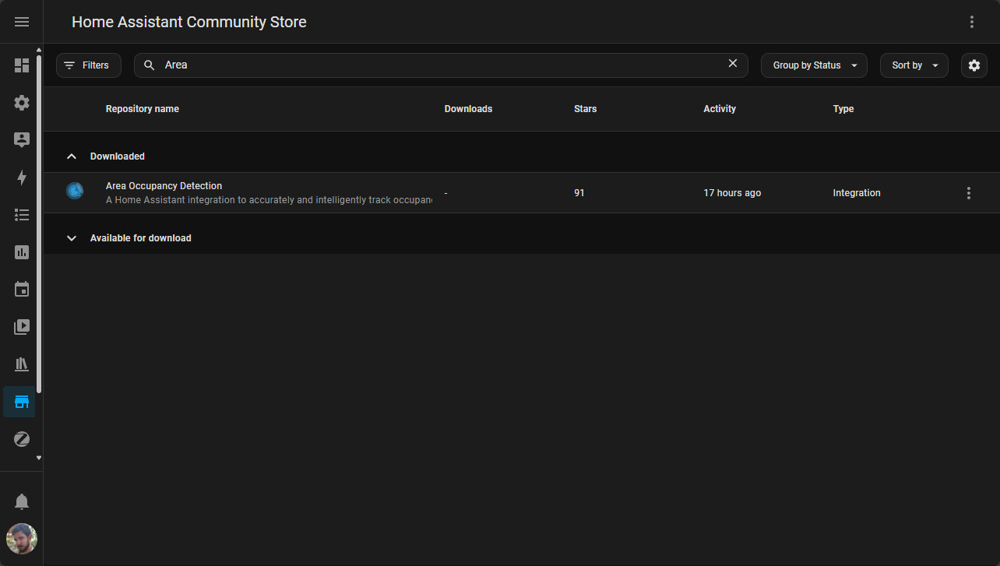
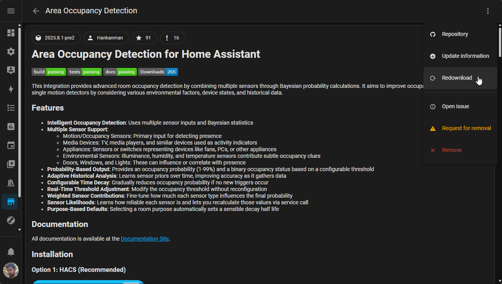
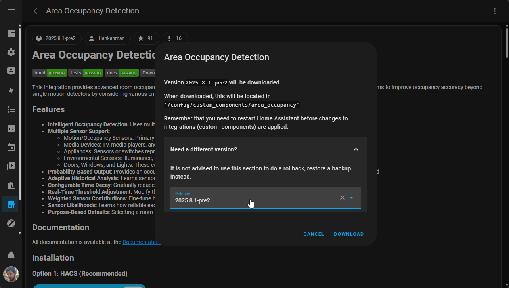

You are always welcome and encouraged to contribute to the project. Trying out the pre-releases and submitting feedback/issues is a great way to help.

## Installing Pre-releases

You can find the available pre-releases on the [releases](https://github.com/Hankanman/Area-Occupancy-Detection/releases) page. Take a backup before installing one, and read its release notes first.

### Home Assistant 2026.11 and newer: Marketplace

The Marketplace offers only stable releases until you include pre-releases for the repository.

**To follow the pre-releases:**

1. Go to **Settings** > **Marketplace** and open **Area Occupancy Detection**.
2. Use the three dots menu in the upper right and select **Include pre-releases**. The page then says "Pre-releases included".
3. New pre-releases now appear under **Settings** > **Updates**. Select **Exclude pre-releases** in the same menu to go back to stable releases only.

**To install one particular version:**

1. In the Marketplace, open Area Occupancy Detection.
2. Use the three dots menu in the upper right and select **Install another version**.
3. Pick the version (e.g. `2026.11.1-pre3`).
4. Restart Home Assistant when the repair asks you to.

Don't use **Install another version** to go back to an older release after its configuration update has run: restore your backup instead.

### Home Assistant 2026.10 and older: HACS

1. Go to HACS
2. Search for "Area Occupancy Detection"
    
3. Select the integration
4. Use the "three dots" menu and select "Redownload"
    
5. Select the version you want to install after expanding the "Need a different version?" section (e.g. `2025.8.1-pre2`) and click on "Download"
    
6. Restart Home Assistant

## Issues

If you find any issues, please report them in the [issue tracker](https://github.com/Hankanman/Area-Occupancy-Detection/issues).

## Discussions

If you have any feedback, please share it in the [discussions](https://github.com/Hankanman/Area-Occupancy-Detection/discussions) section.

